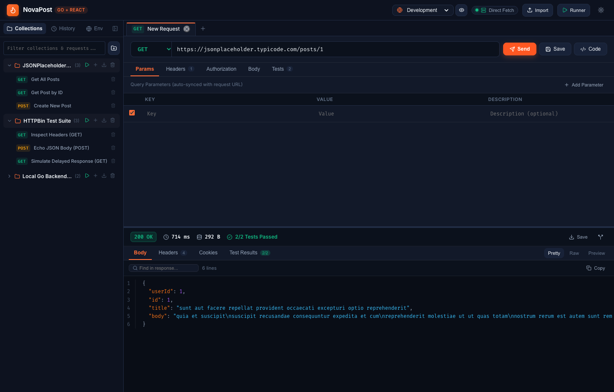
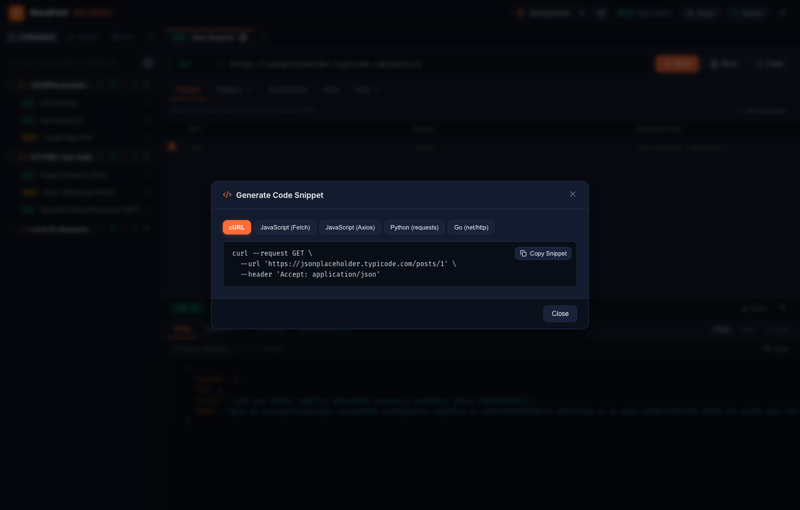
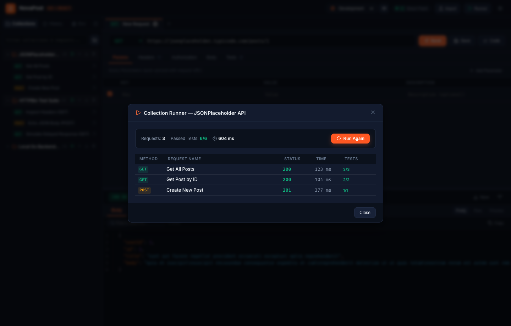
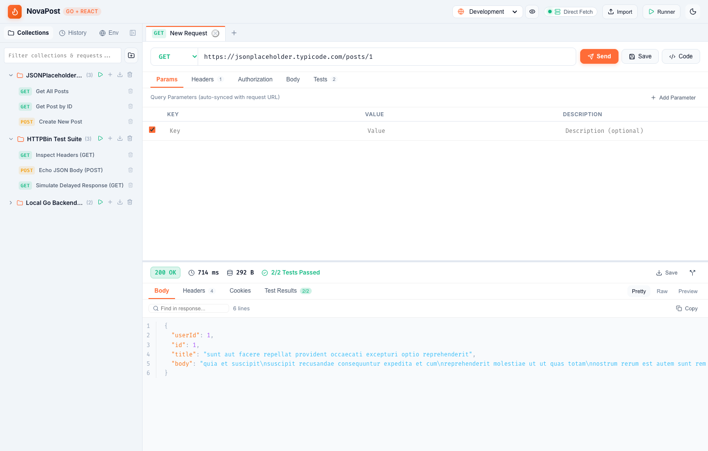

# NovaPost — Postman Clone (Fullstack React JS + Go)

NovaPost est un clone moderne, rapide et sécurisé de Postman conçu avec une architecture professionnelle :
- **Frontend** : React 19, Vite 8, Lucide Icons, Vanilla CSS Design System avec thèmes Dark/Light.
- **Backend** : Go 1.27+, Chi Router v5, Clean Architecture / Standard Go Layout, protection SSRF & DoS, persistance thread-safe.

---

## 📸 Aperçus de l'Application (Screenshots)

### 1. Éditeur de Requêtes & Visualiseur de Réponses (Dark Theme)
> *Exécution d'une requête HTTP GET avec métriques (code 200 OK, latence en ms, taille), corps JSON formaté et coloration syntaxique, numérotation de lignes et validation des tests d'assertion.*



### 2. Générateur de Code Instantané (Code Snippets)
> *Génération de code pour la requête active en cURL, JavaScript (Fetch), JavaScript (Axios), Python (requests) et Go (`net/http`) avec copie en un clic.*



### 3. Collection Runner (Exécution Automatisée & Tests)
> *Exécution séquentielle de l'ensemble des requêtes d'une collection avec vérification des assertions et calcul de la latence globale.*



### 4. Mode Clair (Light Theme)
> *Thème clair moderne avec palette soignée, badges contrastés et lisibilité maximale.*



---

## 🏛️ Architecture Backend (Senior Developer Go)

Le backend respecte les standards de l'ingénierie logicielle Go (Standard Go Project Layout & Clean Architecture) :

```text
backend/
├── cmd/
│   └── server/
│       └── main.go              # Point d'entrée, injection des dépendances, arrêt gracieux (SIGINT/SIGTERM)
├── internal/
│   ├── config/
│   │   └── config.go            # Configuration typée et variables d'environnement
│   ├── domain/
│   │   ├── proxy.go             # Modèles de proxy et interfaces
│   │   ├── collection.go        # Modèles de collections & requêtes
│   │   └── history.go           # Modèles d'historique
│   ├── security/
│   │   ├── ssrf.go              # Moteur anti-SSRF & protection contre le DNS Rebinding
│   │   └── sanitizer.go         # Assainissement des en-têtes et protection CRLF injection
│   ├── middleware/
│   │   ├── security_headers.go  # En-têtes OWASP (HSTS, CSP, X-Frame-Options, etc.)
│   │   ├── ratelimit.go         # Rate limiter en mémoire par Token Bucket par IP
│   │   ├── maxbytes.go          # Limitation de la taille du body (10MB max)
│   │   ├── logger.go            # Journalisation structurée avec propagation de Request ID
│   │   └── recovery.go          # Récupération de panique avec assainissement des erreurs
│   ├── service/
│   │   └── proxy_service.go     # Exécuteur HTTP résilient, pool de connexions, métriques
│   ├── repository/
│   │   ├── json_collection_repo.go # Dépôt thread-safe avec RWMutex et persistance fichier
│   │   └── json_history_repo.go    # Dépôt d'historique avec élagage automatique
│   └── handler/
│       ├── health_handler.go    # Métriques système, mémoire et uptime
│       ├── proxy_handler.go     # Exécution et retransmission des requêtes
│       ├── echo_handler.go      # Serveur miroir pour débogage
│       ├── collection_handler.go# CRUD des collections (/api/collections)
│       └── history_handler.go   # Historique des requêtes (/api/history)
└── data/                        # Données persistées au format JSON
```

---

## 🛡️ Mesures de Sécurité Clés Implémentées

1. **Protection Anti-SSRF & DNS Rebinding** :
   - Validation stricte des protocoles (uniquement `http://` et `https://`).
   - Blocage automatique des adresses d'instance metadata cloud (`169.254.169.254`, `metadata.google.internal`).
   - `net.Dialer.Control` personnalisé inspectant l'IP résolue au moment de la connexion TCP pour bloquer toute attaque par rebinding DNS.
   - Contrôle configurable des sous-réseaux privés RFC1918 et loopbacks via `ALLOW_LOCAL_PROXY`.
2. **Défense contre l'injection CRLF & Request Smuggling** :
   - Détection des retours à la ligne `\r\n` dans les clés et valeurs d'en-tête.
   - Filtrage des en-têtes saut-par-saut (*hop-by-hop*) comme `Transfer-Encoding`, `Connection`, `Upgrade`.
3. **Protection contre le déni de service (DoS)** :
   - Rate limiting par IP avec algorithme Token Bucket et nettoyage automatique.
   - Limitation de la taille de charge utile entrante (`MaxBytesReader` à 10 Mo).
4. **En-têtes de sécurité OWASP** :
   - `X-Content-Type-Options: nosniff`, `X-Frame-Options: DENY`, `Referrer-Policy: strict-origin-when-cross-origin`.
5. **Récupération des paniques & Confidentialité** :
   - Aucune trace de pile interne (*stack trace*) ni chemin de fichier n'est divulgué au client. Les erreurs sont encapsulées avec un identifiant de requête unique (`request_id`).
6. **Arrêt gracieux (Graceful Shutdown)** :
   - Capture de `SIGINT` et `SIGTERM` avec délai d'évacuation de 10 secondes pour terminer les requêtes en vol sans coupure abrupte.

---

## ⚡ Démarrage Rapide

### 1. Démarrer le Backend (Go)
```bash
cd backend
go run cmd/server/main.go
# Le serveur écoute sur http://localhost:8080
```

### 2. Démarrer le Frontend (React)
```bash
cd frontend
npm run dev
# L'interface est disponible sur http://localhost:5173
```

### 3. Lancer les Tests Unitaires
```bash
make test
# ou
cd backend && go test -v ./...
```
